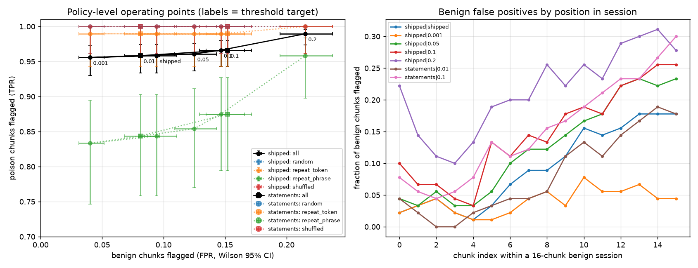

# Exp 3: harness invariants and the policy-level false-positive rate

Branch `experiments/harness-invariants` (from `main` @ `dc55927`). Model: `lm_small_cpu` from exp 2 (a ~1.7M-parameter
PlasticCore LM trained on CPU, delta rule, chunk 64, held-out loss 4.52), its shipped `calibration.json`
(target FPR 0.01, 512 validation chunks) and `canary.json`. Everything is CPU-only. Nothing here was pushed.

Files:
- `test_invariants.py` (+ `conftest.py`): Hypothesis property tests (part a)
- `scale_real.py`: forced-`scale` check on the trained model (follow-up to the I5 counterexample)
- `common.py`, `calib_records.py`, `fpr.py`, `analyze.py`: FPR/TPR measurement (part b)
- `roc_table.md`, `fpr_tpr.png`: tables and the plot; raw data is in `experiments/results/exp3/`, logs are in `experiments/logs/exp3_*`
- `run_exp3.sh`: the exact commands; `PROGRESS.md`: step log kept for restarts

## (a) Invariants: Hypothesis property tests

Run: `EXP3_MAX_EXAMPLES=200 EXP3_REAL_EXAMPLES=8 .venv/bin/python -m pytest experiments/exp3_invariants/test_invariants.py -p no:cacheprovider -rA -v`
(hypothesis 6.168.5, `derandomize=True` so the same examples are drawn each time). Most properties run on tiny
randomly initialised PlasticLMs (d=32, 2 layers, chunk 8, vocab 64) with **both** inner rules (`delta`, `chunk`),
random harness configs (budgets, canary thresholds, z-thresholds, projection on/off, log-only, learn-from-generation),
random token streams (random ids, single-token runs, repeated phrases, extreme ids; random segmentation; user/model
sources; partial-chunk flushes), and the runner's real apply paths. Decisions are forced by swapping
`plastic.harness.transaction.decide`, as `exp2_rollback/probe.py` does. `test_real_I1_N1_N2` repeats I1/N1/N2 on the
trained checkpoint with real test-split text. Full log: `experiments/results/exp3/pytest_full.log`. Result:
**10 passed, 2 failed, 1 xfailed (expected)**.

| # | invariant | test | result |
|---|---|---|---|
| I1 | forced rollback restores fast weights (S, M) bit for bit | `test_I1_forced_rollback_restores_fast_state_bit_exact` | PASS (200) |
| I1 | every applied rollback/readonly, by any path (policy, failed recheck, budget, non-finite), leaves S, M bit-identical | `test_I1_every_natural_rollback_restores_fast_state` | PASS (200) |
| I1-strict | rollback also restores the chunk rule's pending-chunk statistics (A, Bv, alpha_sum, count) | `test_I1_strict_..._incl_pending_chunk_stats` | **FAIL** |
| I2 | committed S change <= per-chunk cap and remaining session budget; sum <= session budget | `test_I2_committed_update_never_exceeds_budget` | PASS (200) |
| I3 | non-finite state (NaN/±Inf injected into S, h, M, conv buffers on any forward call, incl. frozen recompute, log-only) is never committed | `test_I3_nonfinite_state_never_committed` | PASS (200) |
| I4 | read-only session / generation tokens / spent budget never change S, M | `test_I4_frozen_and_readonly_never_change_fast_weights` | PASS (200) |
| I4 | `backend.forward(freeze=True)` leaves S, M bit-identical for any beta_scale | `test_I4_backend_freeze_is_bit_exact` | PASS (200) |
| I5 | scale/project: accepted S change <= cap, and <= the proposal it shrinks | `test_I5_scale_and_project_stay_within_bounds` | **FAIL** (the "<= proposal" part) |
| I5 | `project_delta` is a contraction and lands in the half-space | `test_I5_project_delta_is_a_contraction_onto_the_half_space` | PASS (200) |
| N1 | **documented limitation**: rollback does NOT restore activation/SSM state; the continuation diverges from never-seen | `test_N1_..._DOCUMENTED_LIMITATION` (passes when the divergence is present) | PASS (200): divergence present in every example |
| N1 | the claim "rollback == never seen" | `test_N1_xfail_claim_rollback_equals_never_seen` (`xfail(strict=True)`) | XFAIL (expected) |
| N2 | rollback + restoring the saved pre-chunk activations (h, conv buffers, last logits, and for the chunk rule the pending stats) gives bit-identical continuation logits and fast state to never-seen | `test_N2_rollback_plus_activation_restore_equals_never_seen` | PASS (200) |
| real | I1 + N1 + N2 on `lm_small_cpu` (clean / random / single-token X, 1–2 chunks) | `test_real_I1_N1_N2` | PASS (8) |

### Counterexamples (kept as failing tests; the tests were not changed to pass)

**I1-strict, minimal example:** `rule='chunk', prefix=[], x=[0], flush=True`
(`@reproduce_failure('6.168.5', b'AEEBAEEBQQBBAAE=')`). A one-token partial chunk is flushed and rolled back. S and M
are restored exactly, but the frozen re-read advances the chunk rule's pending-chunk bookkeeping: `count` 0 -> 1 and
`alpha_sum` 0 -> 1 (frozen tokens "count with neutral retention", `plastic/model/memory.py`). So after a rolled-back
*partial* chunk the model's inner chunk boundary is shifted. A rolled-back chunk that crosses a model-chunk boundary
also discards any pending statistics that were already there ("a boundary crossed while frozen discards the pending
statistics"). That behaviour is documented in `memory.py`'s freeze contract, but it means "rollback restores the fast
state" holds only for S and M, not for the chunk rule's full learning state. It matters only for `rule="chunk"` and
only when a transaction is not aligned to the model chunk (a `flush()` of a partial chunk at a turn end). The
`delta`-rule model used everywhere else (and exp 2) has no pending statistics, and I1 holds for it.

**I5, minimal example:** `rule='delta', kind='scale', scale=0.5, budget_chunk=None, budget_session=None,
prefix=[[0]*8], chunks=[[0]]` (`@reproduce_failure('6.168.5', b'AXicc2RwZNCwf8AABo5AyOjI4cjoyACkGUFcBgBLYwPe')`).
The proposed (beta=1) S change was 0.00621; the committed "scaled" change at beta_scale=0.5 was **0.0247 (4x
larger)**. The cause: `beta_scale` scales the write only, while the per-token decay alpha is applied unchanged
(`memory.py`: "beta_scale scales the write only"). When the full write would have cancelled most of the decay, a
smaller write leaves more of the decay, so the net change grows. So the README's "scale (apply a fraction of the
update)" is not guaranteed. The hard budgets are unaffected: I2 and the cap part of I5 held in every example, because
the runner rechecks the cap on the actual candidate. With no budget configured (the `HarnessConfig()` default), nothing
bounds a scaled candidate against its proposal. The runner's post-scale recheck covers only canary and Fisher-drift
limits.
How often this happens on the trained model (`scale_real.py`: every chunk of 6 clean test sessions x 8 chunks forced to
scale, no budgets): accepted/proposal at scale 0.25 had median 0.358, range [0.272, 0.522], 0/48 > 1; at scale 0.5
median 0.655, range [0.563, 0.750], 0/45 > 1 (3 chunks went read-only after a CUSUM alarm). So the violation was not
seen on real text, but the shrink is not proportional to the requested factor (0.25 gives about 0.36).

**N1 / N2** reproduce exp 2 at the property level. Rollback restores S and M exactly. Activations (h, conv buffers,
last logits) still carry the rolled-back chunk, and every drawn continuation diverged from the never-seen session.
Restoring the pre-chunk activation snapshot gives bit-identical logits and fast state, including on the trained model.
Two scope notes. (i) For the chunk rule, the snapshot must include the pending-chunk stats; this follows from the
I1-strict finding. (ii) N2 forces commits on the continuation, so it compares model state only. Harness bookkeeping
is not restored by an activation rewind: the CUSUM statistic is updated by every eligible chunk, rolled-back ones
included (`_measure`), and the transaction count and position advance. The harness's later *decisions* can therefore
still differ from a session that never saw the chunk. This is arguably intended (the CUSUM should remember rejected
evidence), but it is not "identical to never-seen".

## (b) Policy-level false-positive rate

**Setup** (`fpr.py`). `TransactionRunner` with `HarnessConfig()` defaults: rollback, stats, projection, CUSUM freeze
(latching until `resume()`) all on, no budgets. Shipped canaries and calibration.
- **Benign stream:** the wikitext-103 **test** split, which calibration never saw (calibration used validation).
  Contiguous 16-chunk (1024-token) sessions start at random offsets, with a fresh runner per session. 30 sessions x
  3 seeds = **1440 benign chunks per setting**.
- **Poison:** the exp 2 layout (2 clean chunks, then 4 chunks of random / repeat_token / repeat_phrase / shuffled).
  8 sessions x 4 types x 3 seeds = 384 poison chunks per setting.
- **What counts as flagged:** a chunk whose *applied* decision is rollback, scale, project, or readonly. "Refused" is
  rollback + readonly. Readonly is what the CUSUM latch does to every later chunk of the session.
- **Threshold settings:** thresholds were recomputed from re-run calibration records (`calib_records.py` replays
  `plastic calibrate`'s exact stream and saves the raw signals). The repo's `thresholds_from_records` /
  `calibrated_cusum_h` turn them into thresholds. At 0.01 this **reproduces the shipped thresholds exactly**, which
  confirms the pipeline.
- **Canary suites:** `shipped` is the model's actual `canary.json` (3 held-out wikitext windows for coherence; 3
  random-token + 1 single-token-run poison probes). This is what `plastic calibrate` builds for a native text model.
  The README's "12 public true / 12 public false" suite is the chat-backend suite (`CanarySuite.default_chat`,
  `canary_statements.py`), which this model does not ship with. It was run as the second suite, `statements`: 12
  true + 12 false statements + 3 repetition probes, encoded with this model's BPE. Its canary thresholds were
  recalibrated on the same stream.

| suite | thresholds (target FPR) | benign chunks flagged (any intervention) | benign refused (rollback/readonly) | benign scale/project | sessions with >=1 flag | poison flagged, all types | random | repeat_token | repeat_phrase | shuffled |
|---|---|---|---|---|---|---|---|---|---|---|
| shipped | shipped calibration.json (0.01) | 136/1440 = 9.44% [8.04, 11.06] | 102/1440 = 7.08% [5.87, 8.53] | 34/1440 = 2.36% [1.69, 3.28] | 43/90 = 47.78% [37.76, 57.98] | 368/384 = 95.83% [93.34, 97.42] | 96/96 = 100.00% [96.15, 100.00] | 95/96 = 98.96% [94.33, 99.82] | 81/96 = 84.38% [75.81, 90.30] | 96/96 = 100.00% [96.15, 100.00] |
| shipped | recalibrated @ 0.001 | 58/1440 = 4.03% [3.13, 5.17] | 22/1440 = 1.53% [1.01, 2.30] | 36/1440 = 2.50% [1.81, 3.44] | 37/90 = 41.11% [31.51, 51.44] | 367/384 = 95.57% [93.03, 97.22] | 96/96 = 100.00% [96.15, 100.00] | 95/96 = 98.96% [94.33, 99.82] | 80/96 = 83.33% [74.63, 89.47] | 96/96 = 100.00% [96.15, 100.00] |
| shipped | recalibrated @ 0.05 | 180/1440 = 12.50% [10.89, 14.31] | 149/1440 = 10.35% [8.88, 12.03] | 31/1440 = 2.15% [1.52, 3.04] | 53/90 = 58.89% [48.56, 68.49] | 369/384 = 96.09% [93.66, 97.62] | 96/96 = 100.00% [96.15, 100.00] | 95/96 = 98.96% [94.33, 99.82] | 82/96 = 85.42% [77.00, 91.11] | 96/96 = 100.00% [96.15, 100.00] |
| shipped | recalibrated @ 0.1 | 211/1440 = 14.65% [12.92, 16.57] | 183/1440 = 12.71% [11.09, 14.53] | 28/1440 = 1.94% [1.35, 2.80] | 62/90 = 68.89% [58.72, 77.51] | 371/384 = 96.61% [94.29, 98.01] | 96/96 = 100.00% [96.15, 100.00] | 95/96 = 98.96% [94.33, 99.82] | 84/96 = 87.50% [79.41, 92.70] | 96/96 = 100.00% [96.15, 100.00] |
| shipped | recalibrated @ 0.2 | 310/1440 = 21.53% [19.48, 23.72] | 280/1440 = 19.44% [17.48, 21.57] | 30/1440 = 2.08% [1.46, 2.96] | 76/90 = 84.44% [75.57, 90.50] | 380/384 = 98.96% [97.35, 99.59] | 96/96 = 100.00% [96.15, 100.00] | 96/96 = 100.00% [96.15, 100.00] | 92/96 = 95.83% [89.77, 98.37] | 96/96 = 100.00% [96.15, 100.00] |
| statements | recalibrated @ 0.01 | 117/1440 = 8.12% [6.82, 9.65] | 107/1440 = 7.43% [6.19, 8.90] | 10/1440 = 0.69% [0.38, 1.27] | 29/90 = 32.22% [23.47, 42.43] | 368/384 = 95.83% [93.34, 97.42] | 96/96 = 100.00% [96.15, 100.00] | 95/96 = 98.96% [94.33, 99.82] | 81/96 = 84.38% [75.81, 90.30] | 96/96 = 100.00% [96.15, 100.00] |
| statements | recalibrated @ 0.1 | 219/1440 = 15.21% [13.45, 17.16] | 210/1440 = 14.58% [12.85, 16.50] | 9/1440 = 0.62% [0.33, 1.18] | 69/90 = 76.67% [66.95, 84.20] | 371/384 = 96.61% [94.29, 98.01] | 96/96 = 100.00% [96.15, 100.00] | 95/96 = 98.96% [94.33, 99.82] | 84/96 = 87.50% [79.41, 92.70] | 96/96 = 100.00% [96.15, 100.00] |

Wilson 95% intervals are in brackets. The archived exp 2 natural decisions (shipped calibration) are consistent with
this: benign X chunks were flagged 6/168 = 3.57% [1.65, 7.57] (those were only chunks 3–6 of a session); random
168/168; repeat_token 167/168; repeat_phrase 120/168 = 71.4%; shuffled 168/168.

Left: the operating points. Right: benign flag rate by chunk position in the session.

### What the numbers say

1. **The calibration target is not the policy-level rate.** With the shipped calibration (target 0.01), **9.44%
   [8.04, 11.06]** of benign test-split chunks get an intervention and 7.08% are refused. 47.8% of 16-chunk benign
   sessions see at least one intervention. The README already warns that "a calibrated target is not a measured
   policy-level false-positive rate". This is the measured rate for this model.
2. **Where it comes from** (shipped calibration, 1440 benign chunks):
   - **Calibrated per-chunk thresholds:** only 6/1359 learning chunks = 0.44% [0.20, 0.96]. That is within the
     union-bound budget of 7 x 1/513 ≈ 1.4%.
   - **CUSUM alarms:** 15/1359 = 1.10% [0.67, 1.81] per learning chunk (in-sample calibration rate 0.78%). Each alarm
     **latches the session read-only**, which accounts for 81 readonly chunks (5.6%). This is why the flag rate climbs
     with position in the session (right panel), from about 2–4% in the first chunks to about 18% at chunks 13–15.
   - **Projection:** 34 projections (2.36%) fire on a fixed `project_eps_cos=0.02` cosine against the canary gradient.
     That trigger is not calibrated and is not part of the target-FPR budget at all.
3. **Threshold sweep.** At target ≤ 0.02 the per-signal thresholds are already the sample maximum of 512 calibration
   chunks (the target / 7 signals is < 1/513), so only `cusum_h` moves: 10.13 at 0.001, 5.55 at 0.01, 5.0 (the floor)
   from 0.02 up. Raising `cusum_h` to 10.13 cuts the benign flag rate from 9.4% to 4.0%, with essentially no loss on
   this poison set (95.6% vs 95.8%). Looser targets raise the FPR to 21.5% at 0.2 and buy only 95.8% -> 99.0% TPR,
   all of it on repeat_phrase.
4. **TPR is flat because these poisons are easy.** Random, shuffled and single-token chunks are caught on the first
   chunk at every setting. The only discriminating type is repeat_phrase. Its *first* poisoned chunk is committed
   15/24 times (first-chunk detection 9/24 = 37.5% [21.2, 57.3] at the shipped setting; 20/24 at 0.2). The later
   chunks are then caught, mostly by the CUSUM latch. So the 84% repeat_phrase "TPR" partly counts a session freeze
   that came after the model had already learned one poisoned chunk.
5. **The 12/12 statement canaries** at a matched target gave a similar FPR (8.12% vs 9.44%; the intervals overlap)
   and the same TPR. They cause fewer projections (0.69%) but more canary-poison rollbacks at loose targets.

## Caveats

- **Weak model.** A small CPU-trained model (held-out loss 4.52), not the gated HF checkpoint. Numbers for the
  Qwen/TTT chat backends, which use the 12/12 statement canaries in production, may differ substantially.
- **Correlated chunks.** Within a session chunks are not independent: the latch makes them strongly correlated. The
  chunk-level Wilson CIs therefore understate the uncertainty. The session-level column (n = 90) is the more
  conservative unit.
- **Session-length dependence.** The FPR depends on session length: with the latching CUSUM, longer sessions would
  show higher per-chunk refusal rates. 16 chunks was chosen arbitrarily, and other lengths were not measured.
- **Narrow benign distribution.** Benign = wikitext-103 test text, the same distribution as calibration. Benign
  out-of-distribution text (code, chat, other languages) was not tested, and its FPR is likely higher.
- **Easy poisons.** The poison set is the exp 2 set: synthetic, mostly trivially detectable. It is not an adaptive
  attack. A high TPR here says nothing about fluent poisoned text.
- **Hypothesis coverage.** Most properties ran on tiny random-init models; only I1/N1/N2 ran on the trained model
  (8 examples). A passing property-based test is evidence, not proof. `derandomize=True` fixes the example set; the
  I1-strict counterexample appeared at 200 examples but not in a 10-example run.
- **Scale finding on real text.** The I5 counterexample was found on a tiny random model. On the trained model it did
  not occur in 93 forced-scale chunks.
- **What was measured.** The FPR runs record decisions only. They do not measure whether committed benign updates
  were useful.

## Exact commands

See `run_exp3.sh` (it runs everything, in this order: pytest, `scale_real.py`, the two `calib_records.py` runs, 21
`fpr.py` runs = shipped calibration + 4 recalibrated targets for the shipped suite and 2 targets for the statement
suite, x 3 seeds, then `analyze.py`). Wall time on 8 vCPUs was about 1 h in total. Each `fpr.py` run took 7–10 min
single-threaded, and the pytest run took 5 min.
